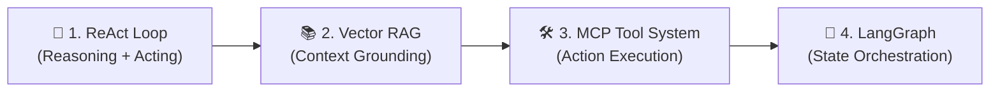
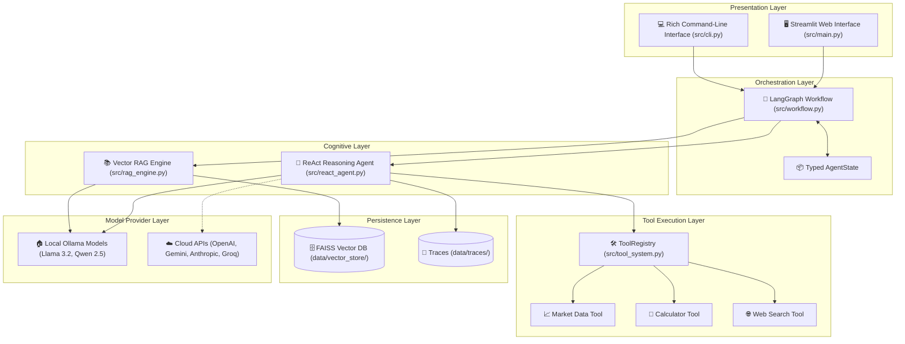

# ⚡ FinAgentic: Autonomous Multi-Pattern Agentic AI Agent System

[](https://www.python.org/)
[](https://python.langchain.com/)
[](https://langchain-ai.github.io/langgraph/)
[](https://streamlit.io/)
[](https://github.com/facebookresearch/faiss)
[](https://opensource.org/licenses/MIT)

> Full architectural schema and state machine specifications are documented in [**`SCHEMA.md`**](./SCHEMA.md).

---

## 📌 Executive Overview

**FinAgentic** is an autonomous, production-grade **Agentic AI Agent System** engineered for deep financial market reasoning, multi-source quantitative retrieval, and structured decision synthesis. 

Unlike conventional chatbots or static LLM pipelines, FinAgentic executes an autonomous cognitive loop capable of **multi-step reasoning**, **grounded retrieval from vector databases**, **MCP-compliant tool calling**, and **state-machine workflow orchestration**.

The platform is designed to operate **100% locally with open-source models (via Ollama)** for privacy and zero API costs, while supporting seamless plug-and-play integration with commercial cloud APIs (OpenAI, Anthropic Claude, Google Gemini, Groq, Mistral, DeepSeek).

---

## 🧠 The 4 Core Agentic Patterns Implemented

FinAgentic implements four foundational patterns of agentic artificial intelligence:



### 1. 🧠 ReAct Pattern (Reasoning + Acting)
- Implements the cognitive loop: `Thought ➜ Action ➜ Observation ➜ Thought ➜ Final Answer`.
- The agent formulates hypotheses, decides which tools to invoke, analyzes tool feedback, and maintains an explicit trace of its reasoning steps.
- **Code:** [`src/react_agent.py`](./src/react_agent.py)

### 2. 📚 Vector RAG (Retrieval-Augmented Generation)
- Eliminates hallucination by anchoring agent responses in factual documents (10-K filings, earnings transcripts, market reports).
- Uses **FAISS** vector database with semantic dense embeddings (`nomic-embed-text`) and recursive character chunking.
- **Code:** [`src/rag_engine.py`](./src/rag_engine.py)

### 3. 🛠️ MCP-Compliant Tool System
- Provides standard tool execution schemas conforming to the Model Context Protocol (MCP).
- Built-in tools:
  - `stock_data`: Real-time market metrics, valuation multiples, 52-week ranges via `yfinance`.
  - `calculator`: Precision numerical computation and financial ratio evaluation.
  - `web_search`: Live industry and market intelligence search.
- **Code:** [`src/tool_system.py`](./src/tool_system.py)

### 4. 🔄 LangGraph State Graph Workflow
- Orchestrates multi-agent transitions through a typed `AgentState` state graph.
- Manages sequential pipeline stages: `Query Analysis ➜ Market Data Collection ➜ Vector Document Retrieval ➜ Technical Indicator Computation ➜ Executive Report Synthesis`.
- **Code:** [`src/workflow.py`](./src/workflow.py)

---

## 📐 Development Schema & System Architecture

A detailed system schema with sequence diagrams, state machines, and JSON data definitions is available in [**`SCHEMA.md`**](./SCHEMA.md).



---

## 📁 Project Structure

```
.
├── .env                       # Active API keys and environment variables (git-ignored)
├── .env.example               # Template for API keys and configuration
├── .gitignore                 # Protects keys, temporary files, and vector caches
├── LICENSE                    # Clean MIT open-source license
├── README.md                  # Comprehensive system documentation
├── requirements.txt           # Python package dependencies
├── run.py                     # Main application launcher (Streamlit UI)
├── setup.py                   # Environment setup & model verification script
├── SCHEMA.md                  # System development schema & architectural diagrams
├── src/                       # Core system implementation
│   ├── __init__.py            # Package root & metadata
│   ├── config.py              # Configuration manager & API key loader
│   ├── react_agent.py         # ReAct reasoning loop implementation
│   ├── rag_engine.py          # Vector RAG engine with FAISS index
│   ├── tool_system.py         # MCP-style tool system & registry
│   ├── workflow.py            # LangGraph workflow orchestration
│   ├── main.py                # Streamlit interactive dashboard
│   └── cli.py                 # Command-line interface
├── tests/                     # Test suite
│   ├── __init__.py
│   ├── test_all.py            # Full system and component tests
│   └── test_ollama.py         # Ollama connection and model tests
├── docs/                      # Documentation and visual assets
│   └── images/                # Architecture diagrams & flowcharts
└── data/                      # Persistent runtime storage
    ├── vector_store/          # FAISS vector database storage
    └── traces/                # Agent reasoning execution traces
```

---

## 🚀 Quick Start Guide

### Step 1: Clone and Enter the Repository

```bash
git clone https://github.com/SabarinathTS/FinAgentic.git
cd FinAgentic
```

### Step 2: Create and Activate Virtual Environment

```bash
# macOS/Linux:
python3 -m venv ai-agents-env
source ai-agents-env/bin/activate

# Windows (PowerShell):
python -m venv ai-agents-env
.\ai-agents-env\Scripts\activate
```

### Step 3: Install Dependencies

```bash
pip install --upgrade pip
pip install -r requirements.txt
```

### Step 4: Configure API Keys & Environment

A pre-configured [`.env`](./.env) file is provided. You can also copy from [`.env.example`](./.env.example):

```bash
cp .env.example .env
```

Open `.env` to configure your preferred model settings. If using **100% local models with Ollama**, no API keys are required. If using commercial providers (OpenAI, Anthropic, Gemini, Groq), paste your keys in the corresponding fields.

### Step 5: Start Local Models (Ollama)

1. Install Ollama from [ollama.ai](https://ollama.ai/download).
2. Start the Ollama background service:
   ```bash
   ollama serve
   ```
3. Pull the required models:
   ```bash
   ollama pull llama3.2          # Core reasoning & ReAct agent (3GB)
   ollama pull nomic-embed-text   # Semantic embedding model for RAG (274MB)
   ollama pull qwen2.5           # Quantitative financial analysis model
   ```

### Step 6: Verify System Health

Run the automated verification suite:

```bash
python tests/test_all.py
```

### Step 7: Launch the Application

```bash
python run.py
# Or directly with Streamlit:
streamlit run src/main.py
```

Open your browser at **`http://localhost:8501`**.

---

## 💻 Command-Line Interface (CLI)

For headless execution or rapid testing, FinAgentic includes a complete CLI:

```bash
# 1. Run ReAct reasoning on a financial problem
python src/cli.py react "What is Apple's P/E ratio and is it overvalued?"

# 2. Query the vector RAG engine
python src/cli.py rag AAPL "What are the primary operational risks?"

# 3. Execute a specific MCP tool directly
python src/cli.py tool stock_data --params '{"ticker": "NVDA"}'

# 4. Execute the complete LangGraph workflow
python src/cli.py workflow MSFT --query "Provide comprehensive investment analysis"

# 5. List available models
python src/cli.py models
```

---

## 🔑 Centralized API Key Management

FinAgentic features automated configuration loading in [`src/config.py`](./src/config.py) via `python-dotenv`:

```python
from src.config import config

# Inspect configured services
print(config.list_configured_keys())

# Access keys dynamically
openai_key = config.get_api_key("openai")
tavily_key = config.get_api_key("tavily")
```

All keys in `.env` remain strictly local and protected from git commits via [`.gitignore`](./.gitignore).

---


## 📄 License

This project is licensed under the terms of the **MIT License**. See [LICENSE](./LICENSE) for details.