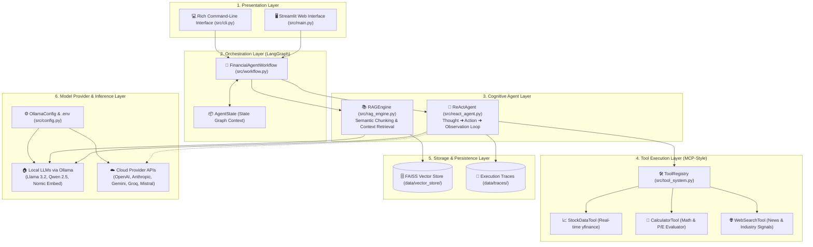
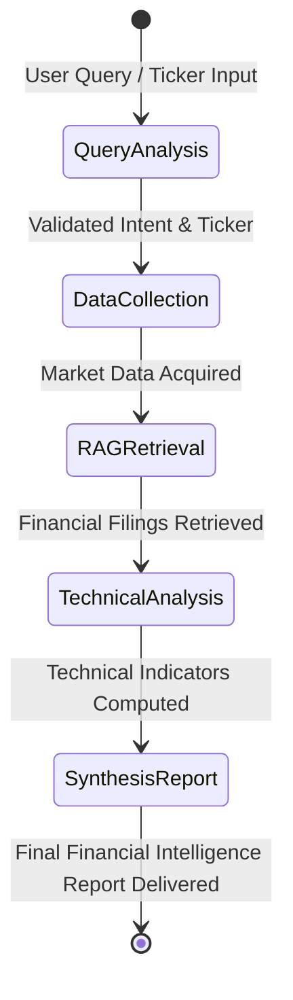
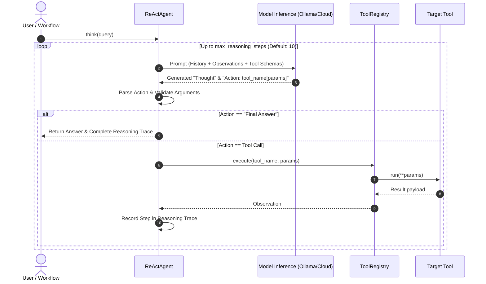
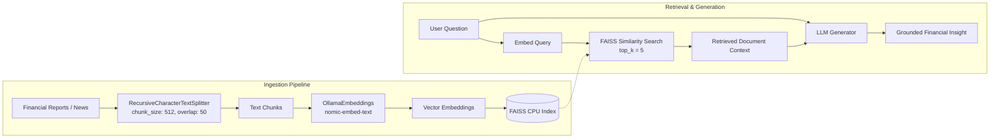

# 📐 System Development Schema & Architecture Specification

Technical architecture and schema reference for the FinAgentic autonomous agent system.

---

## 1. High-Level System Architecture Schema

The FinAgentic platform is organized into six decoupled architectural layers: **Presentation**, **Orchestration**, **Cognitive Agents**, **Tool Execution**, **Persistence/Memory**, and **Model Providers**.



---

## 2. LangGraph State Machine Workflow Schema

The LangGraph orchestrator models the financial reasoning process as a deterministic **Directed Acyclic Graph (DAG)** with strongly typed state transitions.

### 2.1 State Graph Lifecycle Diagram



### 2.2 State Transition Nodes

| Node Name | Input State Attributes | Output State Mutations | Responsibilities |
|---|---|---|---|
| `analyze_query` | `query`, `ticker` | `step`, `reasoning_steps` | Parses ticker symbols, validates query intent, initializes analysis strategy. |
| `collect_data` | `ticker` | `market_data`, `reasoning_steps` | Invokes `StockDataTool` via tool registry to fetch real-time price, P/E, volume, and beta. |
| `retrieve_context` | `query`, `ticker` | `rag_context`, `reasoning_steps` | Queries the FAISS vector database for 10-K, 10-Q, and company filing disclosures. |
| `analyze_technicals`| `market_data` | `technical_signals`, `reasoning_steps` | Executes quantitative metrics (Moving Averages, RSI indicators, Valuation spreads). |
| `synthesize_report` | All Accumulated State | `final_report`, `status` | Synthesizes an executive decision report with recommendations and risk factors. |

---

## 3. ReAct (Reasoning + Acting) Cognitive Loop Schema

The ReAct pattern implements a multi-hop cognitive loop where the model iteratively reasons about the current observation before selecting an action.



---

## 4. Vector RAG Pipeline & Storage Schema

The Retrieval-Augmented Generation (RAG) engine operates on dense semantic vector embeddings stored in a local FAISS index.



---

## 5. Data & State Schema Specifications

### 5.1 LangGraph State Schema (`AgentState`)

```json
{
  "$schema": "https://json-schema.org/draft/2020-12/schema",
  "title": "AgentState",
  "type": "object",
  "properties": {
    "query": { "type": "string", "description": "User analytical prompt" },
    "ticker": { "type": "string", "description": "Target stock ticker symbol (e.g., AAPL, NVDA)" },
    "market_data": { 
      "type": "object", 
      "properties": {
        "price": { "type": "number" },
        "pe_ratio": { "type": "number" },
        "market_cap": { "type": "number" },
        "52_week_high": { "type": "number" },
        "52_week_low": { "type": "number" }
      }
    },
    "rag_context": { 
      "type": "array", 
      "items": { "type": "string" },
      "description": "Retrieved document text excerpts"
    },
    "technical_signals": {
      "type": "object",
      "properties": {
        "trend": { "type": "string", "enum": ["Bullish", "Bearish", "Neutral"] },
        "rsi": { "type": "number" },
        "recommendation": { "type": "string" }
      }
    },
    "reasoning_steps": {
      "type": "array",
      "items": {
        "type": "object",
        "properties": {
          "step_number": { "type": "integer" },
          "thought": { "type": "string" },
          "action": { "type": "string" },
          "observation": { "type": "string" }
        }
      }
    },
    "final_report": { "type": "string", "description": "Synthesized executive report" },
    "status": { "type": "string", "enum": ["initialized", "in_progress", "completed", "failed"] }
  },
  "required": ["query", "ticker"]
}
```

### 5.2 Tool Interface Schema (`BaseTool`)

Each tool registered in the `ToolRegistry` conforms to the Model Context Protocol (MCP) tool format:

```json
{
  "name": "stock_data",
  "description": "Fetch real-time market data, valuation metrics, and fundamentals for a given equity ticker.",
  "parameters": {
    "type": "object",
    "properties": {
      "ticker": {
        "type": "string",
        "description": "Standard stock exchange ticker symbol (e.g., AAPL, MSFT, GOOGL)"
      }
    },
    "required": ["ticker"]
  }
}
```

---

## 6. Configuration & Runtime Environment Schema

The application configuration in `src/config.py` parses parameters with hierarchical precedence:
`CLI Flags > Environment Variables (.env) > Built-in Defaults`.

```json
{
  "OLLAMA_BASE_URL": { "type": "string", "default": "http://localhost:11434" },
  "REASONING_MODEL": { "type": "string", "default": "llama3.2:latest" },
  "ANALYSIS_MODEL": { "type": "string", "default": "qwen2.5:latest" },
  "EMBEDDING_MODEL": { "type": "string", "default": "nomic-embed-text:latest" },
  "VECTOR_STORE_TYPE": { "type": "string", "enum": ["faiss", "chroma"], "default": "faiss" },
  "LOG_LEVEL": { "type": "string", "default": "INFO" },
  "DATA_DIR": { "type": "string", "default": "./data" },
  "API_KEYS": {
    "OPENAI_API_KEY": { "type": "string", "sensitive": true },
    "ANTHROPIC_API_KEY": { "type": "string", "sensitive": true },
    "GEMINI_API_KEY": { "type": "string", "sensitive": true },
    "GROQ_API_KEY": { "type": "string", "sensitive": true },
    "TAVILY_API_KEY": { "type": "string", "sensitive": true },
    "FINNHUB_API_KEY": { "type": "string", "sensitive": true },
    "ALPHA_VANTAGE_API_KEY": { "type": "string", "sensitive": true }
  }
}
```


